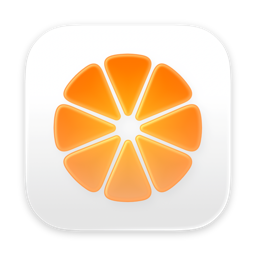
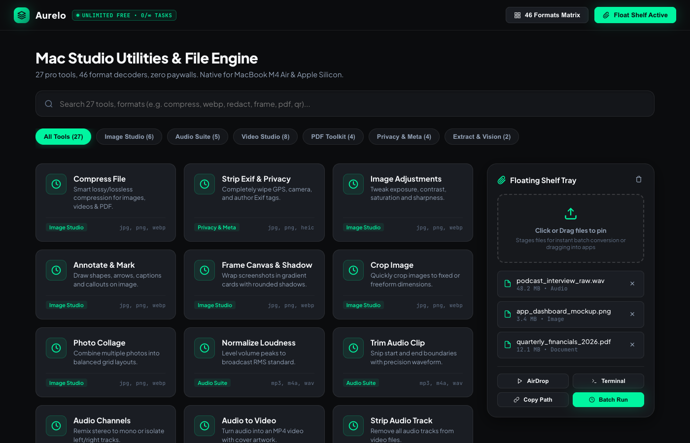

# Aurelo — The Unlimited Native Mac File Utility & Studio

<div align="center">
  
  <h1>AURELO</h1>
  <p><strong>The Unlimited, 100% Offline File Utility Suite for Apple Silicon</strong></p>
  <p>Created & Developed by <strong>PAL GHORI</strong></p>

  <p>
    
    
    
    
    
    
  </p>

  <br />

  
</div>

---

## ✦ Overview

**Aurelo** is an ultra-fast, native macOS utility built from the ground up for Apple Silicon Macs. It replaces 5+ expensive, fragmented utilities (PDF editors, video trimmers, format converters, audio normalizers, and floating shelves) with a single, unified, obsidian dark-themed workspace.

Unlike restricted commercial utilities, **Aurelo is completely free with zero limits**:
- 🔒 **100% On-Device & Private**: Zero data sent to cloud servers. All processing uses native Apple Silicon frameworks (`CoreGraphics`, `AVFoundation`, `PDFKit`, and `Vision`).
- ⚡ **Zero Subscriptions / Quotas**: No "2 files per day" paywalls.
- 🚀 **Hardware-Accelerated**: Sub-second execution speeds powered by the Apple Neural Engine.

---

## ✨ Studio Suites & Tool Capabilities

### 📄 PDF Toolkit
* **Merge PDF Documents**: Combines multiple PDF files into a single continuous document without quality loss.
* **Split PDF Pages**: Slices multi-page documents into individual, clean single-page PDFs.
* **Create PDF from Media**: Converts loose images (PNG, JPG, HEIC, WebP) or markdown/text notes into professional multi-page PDFs.
* **Organize & Rotate**: Rotates pages 90° clockwise and standardizes page orientations.
* **PDF to High-Res Images**: Renders every page of a PDF document into standalone, crisp PNG images.

### 🎥 Video Studio
* **Extract Snapshots**: One-click frame grabber extracting full-resolution still shots from any video.
* **Concatenate Videos**: Sequentially stitches multiple video clips into a single continuous MP4.
* **Trim Video Timeline**: Precision start and duration snip.
* **Adjust Video Speed**: 2x fast-forward or slow-motion video playback rendering.
* **Smart Video Compression**: Downscales large footage using hardware-accelerated medium-quality MP4 encoding (saving 40–70% disk space).
* **Mute Video**: Removes all audio tracks with zero re-encoding artifacts.

### 📸 Image Studio
* **Strip Exif & Privacy**: Completely wipes GPS coordinates, camera serial numbers, and author tags from photos.
* **Frame Canvas & Shadow**: Wraps screenshots in custom gradient cards with soft drop shadows for social media presentations.
* **Photo Collage**: Combines 2 to 4 photos into an auto-balanced 2048×2048 grid with aspect-fill framing and rounded cells.
* **Crop Image**: Quick center-ratio cropping.
* **Image Adjustments**: Real-time exposure, contrast, saturation, and brightness tuning.
* **Redact & Blur**: Adds solid privacy blackout blocks with protective mint borders over confidential areas.
* **Universal Format Converter**: Seamlessly converts between JPG, PNG, TIFF, and BMP formats.

### 🎵 Audio Suite
* **Broadcast Loudness Normalization**: Normalizes uneven podcast/vocal tracks to standard broadcast M4A levels.
* **Trim Audio Snippet**: Snips start/end boundaries with precision timestamps.
* **Audio-to-Video**: Pairs an audio clip with cover artwork to produce a ready-to-upload MP4.

### 🔍 Extract & Vision (Apple Neural Engine)
* **OCR Text Extraction**: On-device text recognition extracting all text from photos, screenshots, and scanned PDFs directly into a `.txt` file using Apple's Vision Neural Engine.
* **QR & Barcode Scanner**: Instant local detection and payload decoding for QR codes, Aztec, and Barcodes.
* **Extract Archive**: Unpacks ZIP, TAR, GZ, and RAR archives instantly via native system tools.

### 🗂️ Persistent Floating Desktop Shelf
* A translucent frosted-glass HUD tray (`NSPanel`) that stays pinned on top of all your open apps and across macOS Spaces.
* Drag files onto the shelf to stage them, then drag them directly into Mail, Final Cut, Slack, or Xcode.
* 1-click **"Terminal"** button next to each file to launch macOS Terminal directly inside that file's folder.

---

## 🚀 Quick Start

### Prerequisites
* macOS 13.0 (Ventura) or newer
* Apple Silicon Mac (M1, M2, M3, M4)
* Xcode Command Line Tools (`xcode-select --install`)

### 1. Clone & Build
```bash
git clone https://github.com/palghori/Aurelo.git
cd Aurelo
./build.sh
```

### 2. Launch
```bash
open build/Aurelo.app
```

### 3. Run Automated Tests
Aurelo includes a comprehensive 25-feature test harness:
```bash
./test.sh
```

---

## 🛠 Architecture & Tech Stack

```
Aurelo/
├── Sources/
│   ├── main.swift                 # Entry point & runtime lifecycle
│   ├── AureloApp.swift            # Menu bar status item & app delegate
│   ├── Theme.swift                # Graphite & Mint design system tokens
│   ├── Models/
│   │   ├── FileTool.swift         # Tool definitions & metadata
│   │   ├── Format.swift           # 46 format decoders & categorization
│   │   ├── FileAction.swift       # Quick desktop actions
│   │   └── FloatingShelfModel.swift # Translucent floating shelf state
│   ├── Views/
│   │   ├── MainWindowView.swift   # Main studio grid & async dispatch
│   │   └── FloatingShelfWindow.swift # Floating glass desktop tray
│   └── Engine/
│       └── ProcessingEngine.swift # AVFoundation, CoreImage, PDFKit & Vision
├── Tests/
│   └── test_engine.swift          # 25-feature automated verification suite
├── Resources/                     # App icon, screenshot, and assets
├── build.sh                       # One-click native compilation & app bundler
├── test.sh                        # One-click automated test runner
└── preview.html                   # Interactive web showcase & simulator
```

---

## 👤 Author

**PAL GHORI**  
*Creator and Lead Developer of Aurelo*  
* GitHub: [@palghori](https://github.com/palghori)

---

## 📄 License

This project is licensed under the **MIT License** — feel free to use, modify, and distribute.
